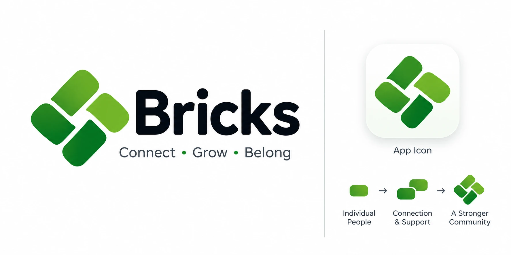

# Bricks brand

The logo sheet above is the approved logo (owner, 2026-11-12): the wordmark with the four-brick mark, the app icon, and the three-step idea underneath.

## The idea
Four connected pieces: individual people coming together to build a stronger community.

- **Four elements** represent individuality and contribution.
- **Their connection** represents belonging and mutual support.
- **The unified shape** represents collective strength.
- **Green** represents growth, vitality and trust.

Read left to right on the sheet: *Individual People* -> *Connection & Support* -> *A Stronger Community*.

## Wordmark and tagline
- Wordmark: **Bricks**
- Tagline: **Connect · Grow · Belong**

## Notes for whoever builds with it
- The app's brand green is `#1B7F3B` (`app/src/theme/tokens.ts`); the mark uses three greens from light to deep.
- The tagline is now **Connect · Grow · Belong**. Some app copy and docs still say "Connect. Grow. Participate." (for example the welcome screen in `06-technical/ui-build-spec.md`); change them when the logo goes into the app.
- The sheet is a picture, not a source file. Clean vector (SVG) versions of the mark, the wordmark and the app icon are not made yet; the app icon and splash in `app/assets` and `app/app.json` have not been replaced.
